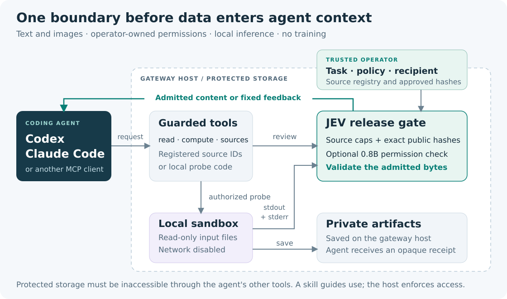
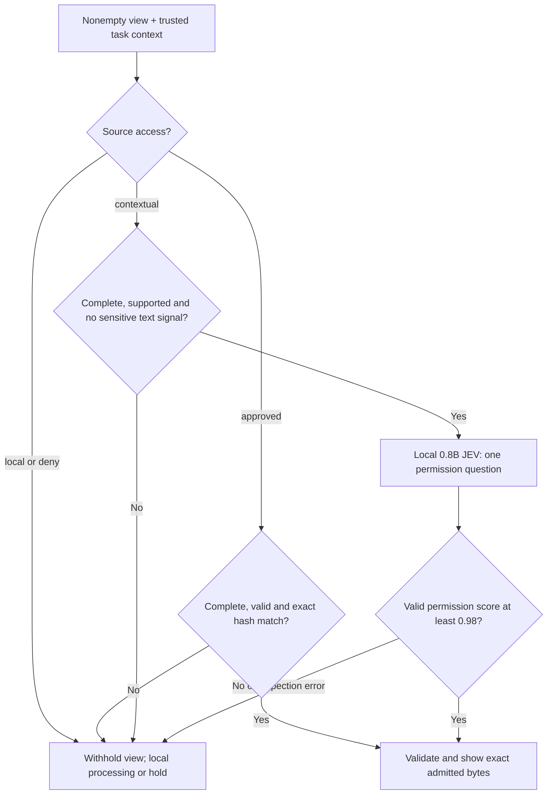
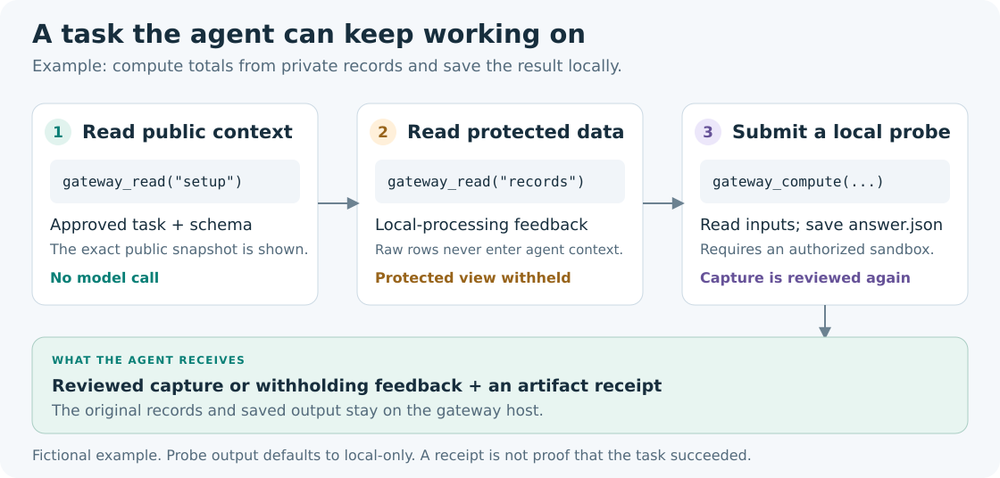

# JEV Gateway — PII/PHI Guardrails for Coding Agents

[](https://github.com/d0ng231/jev-gtw/actions/workflows/test.yml)
[](pyproject.toml)
[](LICENSE)

**Local data-access controls for Codex, Claude Code and other MCP agents.**
Review text and images before they enter agent context, withhold protected
records, and let the agent continue through local computation. Built for
personally identifiable information (PII) and protected health information
(PHI) workflows. **Inference only; no training.**

[Quick start](#quick-start-no-gpu-required) · [Connect your agent](#connect-codex-or-claude-code) ·
[How it works](#how-a-view-is-released) · [Results](#what-has-been-tested) ·
[Agent skill](skills/jev-gtw/SKILL.md)



| Capability | What you get |
|---|---|
| **Source permissions first** | Protected views stay local. Approved public snapshots pass only when their exact content hash matches. |
| **Smaller local inspector** | The default is **StartLux-Decision-v1.1-0.8B-Instant**. Contextual sources receive at most one typed permission check. |
| **Text and image review** | Captured text and supported RGB PNGs pass through the same release boundary. |
| **Useful continuation** | Fixed feedback directs the agent toward an approved view or an isolated local probe. |
| **Portable agent skill** | One skill and three MCP tools for Codex, Claude Code and compatible clients. |

**Current scope:** a research prototype with strict source controls. The learned
contextual reviewer over-blocks permitted data; it is not validated as a general
PHI detector. The [completed results](#what-has-been-tested) report both withholding
and permitted-view access.

## Quick start: no GPU required

Requires Python 3.10+ on POSIX. Install from source; the core has no external
Python dependencies, and the MCP extra provides the tool server.

```bash
git clone https://github.com/d0ng231/jev-gtw.git
cd jev-gtw
python3 -m venv .venv
. .venv/bin/activate
python -m pip install -e '.[mcp]'

jev-gtw check --config examples/gateway.json
jev-gtw read --config examples/gateway.json setup
jev-gtw read --config examples/gateway.json records
```

| Demo request | Expected result |
|---|---|
| `setup` | `show`: the exact approved task and schema. |
| `records` | `local`: fixed feedback; the fictional records stay local. |
| `public_image` | `show`: an exact approved PNG, returned as base64 by the CLI and as an image through MCP. |

The demo uses exact public grants and protected-source rules, so no model server
is needed. Probe execution is disabled until a sandbox is configured.

## Connect Codex or Claude Code

From the checkout above, install the skill into this demo project:

```bash
python tools/install_skill.py --target both --project .
```

Register the server in the client you use. These commands resolve the executable
and configuration to absolute paths, so the server can start from another directory.

**Codex**

```bash
codex mcp add jev_gtw -- "$PWD/.venv/bin/jev-gtw" serve --config "$PWD/examples/gateway.json"
```

**Claude Code**

```bash
claude mcp add --transport stdio --scope user jev_gtw -- "$PWD/.venv/bin/jev-gtw" serve --config "$PWD/examples/gateway.json"
```

Start the agent in this project and invoke **`$jev-gtw`** in Codex or
**`/jev-gtw`** in Claude Code. To use the skill in another task repository, pass
that directory to `--project` instead. The installer refuses to overwrite an
existing skill. Server registration changes the selected client's MCP settings.

Try: “Use the JEV gateway to read the public setup and check whether the records
can be viewed. If they must stay local, explain the permitted next step.”

| MCP tool | Purpose |
|---|---|
| `gateway_sources` | Discover registered source handles and coarse permissions. |
| `gateway_read(source_id)` | Receive an admitted text/image view or withholding feedback. |
| `gateway_compute(source_ids, code)` | Run a permitted Python probe in a configured sandbox; review its capture and keep artifacts local. |

The [integration guide](docs/INTEGRATIONS.md) covers the local inspector,
Docker/Apptainer configuration, custom harness API and deployment boundary.

## How a view is released



Redaction is not an automatic release path. A transformed view still needs its
own review. The 0.98 threshold is **not a calibrated 98% safety guarantee**.
Complete empty observations can pass without a model call when source policy allows.
See the [architecture](docs/ARCHITECTURE.md) for exact source-cap and validation behavior.

### Continue a task without displaying its records



For contextual model review, install the official StartLux runtime in a GPU
environment and run `bash tools/serve_inspector.sh`; it downloads the pinned
0.8B checkpoint. Set `TMPDIR` to private scratch first. For local probes, configure
a sandbox as described in the [setup guide](docs/INTEGRATIONS.md#configure-local-computation).

**Deployment boundary:** protected storage and operator configuration must be
inaccessible through the agent's other tools. This skill guides use of the
provided MCP routes; it does not automatically intercept native shell/read/image
tools, other servers or direct chat uploads.

## What has been tested

| Completed check | Result |
|---|---|
| 4,528 existing text/image cases | 1,948/1,948 prohibited originals withheld; **0/2,580 permitted views released**. |
| 512 reproducible policy fixtures | All 256 prohibited views withheld; all 128 exact approved public snapshots released; all 128 contextual public views withheld. |
| Boundary and integration checks | 57 tests + 1,280 generated contract trials passed, including real MCP stdio calls and skill installation. |
| Actual Apptainer probes | 11 scenarios passed; an aggregate was saved locally without exposing input records. |

The contextual model path is **too conservative to claim useful automatic
permission judgment** at this threshold. Exact approved public views provide
the tested route for navigation. Full native Codex/Claude conversations were
not run in this study.

The large cohort made 2,572 model calls. Warm six-worker decision latency for
inspected cases was approximately **106 ms p50 / 265 ms p95** on one A100;
this excludes startup and is not an isolated hardware benchmark. No weights
were updated. [Full methods and limitations](docs/RESULTS.md) ·
[HTML report — download and open locally](index.html) · [Machine-readable evidence](reports/release-v1/).

## Reproduce

```bash
python -m pip install -e '.[dev]'
python -B -m unittest discover -s tests -v
python tools/make_cases.py --out /path/to/new-fixtures
python tools/evaluate.py --cases /path/to/new-fixtures/cases.json \
  --out /path/to/new-results --url http://127.0.0.1:8090
```

Use a new directory for every evaluation. The synthetic fixtures are policy
controls, not a clinical PHI benchmark. External source rows, research traces,
credentials and model weights are excluded. `tools/smoke_sandbox.py` exercises
an operator-configured container with fictional inputs. No training scripts
are included.

## License

Gateway code: **MIT**. Default [StartLux model weights](https://huggingface.co/startlux-models/StartLux-Decision-v1.1-0.8B-Instant):
**CC BY-NC 4.0**, separately licensed. The model is not an unrestricted commercial
dependency. See [NOTICE](NOTICE).
