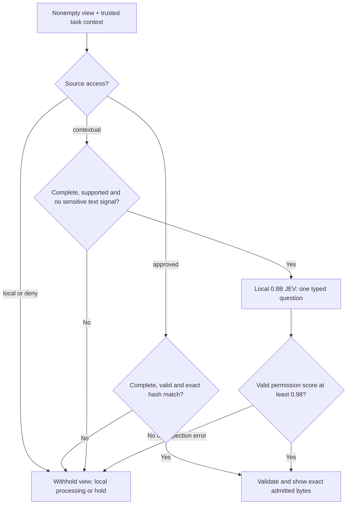

# JEV Gateway — PII/PHI Guardrails for Coding Agents

[](https://github.com/d0ng231/jev-gtw/actions/workflows/test.yml)
[](pyproject.toml)
[](LICENSE)

**Local data-access controls for Codex, Claude Code and other MCP agents.**
Review text and images before they enter agent context, withhold protected
records, and let the agent continue through local computation. Built for
personally identifiable information (PII) and protected health information
(PHI) workflows. **Inference only; no training.**

[Quick start](#quick-start-no-gpu-required) · [Connect your agent](#connect-codex-or-claude-code) ·
[How it works](#how-a-view-is-released) · [Results](#what-has-been-tested) ·
[Agent skill](skills/jev-gtw/SKILL.md)


| Capability | What you get |
|---|---|
| **Source permissions first** | Protected views stay local. Approved public snapshots pass only when their exact content hash matches. |
| **Smaller local inspector** | The default is **StartLux-Decision-v1.1-0.8B-Instant**. Contextual sources receive at most one typed permission check. |
| **Text and image review** | Captured text and supported RGB PNGs pass through the same release boundary. |
| **Useful continuation** | Configured next steps point to an approved setup view or an available isolated probe. |
| **Fast repeat decisions** | A bounded 30-second score cache reuses identical requests; context or data changes invalidate the key. |
| **Portable agent skill** | One skill and three MCP tools for Codex, Claude Code and compatible clients. |

**Current scope:** a research prototype with strict source controls. The contextual reviewer still over-blocks permitted
data, especially images; it is not validated as a general PHI detector. The [completed results](#what-has-been-tested) report both withholding
and permitted-view access.

## Quick start: no GPU required

Requires Python 3.10+ on POSIX. Install from source; the core has no external
Python dependencies, and the MCP extra provides the tool server.

```bash
git clone https://github.com/d0ng231/jev-gtw.git
cd jev-gtw
python3 -m venv .venv
. .venv/bin/activate
python -m pip install -e '.[mcp]'

jev-gtw check --config examples/gateway.json
jev-gtw read --config examples/gateway.json setup
jev-gtw read --config examples/gateway.json records
```

| Demo request | Expected result |
|---|---|
| `setup` | `show`: the exact approved task and schema. |
| `records` | `local`: fixed feedback; the fictional records stay local. |
| `public_image` | `show`: an exact approved PNG, returned as base64 by the CLI and as an image through MCP. |

The demo uses exact public grants and protected-source rules, so no model server
is needed. Probe execution is disabled until a sandbox is configured.

## Connect Codex or Claude Code

From the checkout above, install the skill into this demo project:

```bash
python tools/install_skill.py --target both --project .
```

Register the server in the client you use. These commands resolve the executable
and configuration to absolute paths, so the server can start from another directory.

**Codex**

```bash
codex mcp add jev_gtw -- "$PWD/.venv/bin/jev-gtw" serve --config "$PWD/examples/gateway.json"
```

**Claude Code**

```bash
claude mcp add --transport stdio --scope user jev_gtw -- "$PWD/.venv/bin/jev-gtw" serve --config "$PWD/examples/gateway.json"
```

Start the agent in this project and invoke **`$jev-gtw`** in Codex or
**`/jev-gtw`** in Claude Code. To use the skill in another task repository, pass
that directory to `--project` instead. The installer refuses to overwrite an
existing skill. Server registration changes the selected client's MCP settings.

Try: “Use the JEV gateway to read the public setup and check whether the records
can be viewed. If they must stay local, explain the permitted next step.”

| MCP tool | Purpose |
|---|---|
| `gateway_sources` | Discover registered source handles and coarse permissions. |
| `gateway_read(source_id)` | Receive an admitted text/image view or withholding feedback. |
| `gateway_compute(source_ids, code)` | Run a permitted Python probe in a configured sandbox; review its capture and keep artifacts local. |

The [integration guide](docs/INTEGRATIONS.md) covers the local inspector,
Docker/Apptainer configuration, custom harness API and deployment boundary.

## How a view is released



The default `hybrid` inspector asks about disclosure risk for text and permission
for images, retaining the 0.98 release threshold. Unicode and encoded identifiers
receive bounded checks before inference.

Redaction is not an automatic release path. A transformed view still needs its
own review. The 0.98 threshold is **not a calibrated 98% safety guarantee**.
Complete empty observations can pass without a model call when source policy allows.
See the [architecture](docs/ARCHITECTURE.md) for exact source-cap and validation behavior.

### Continue a task without displaying its records


For contextual model review, install the official StartLux runtime in a GPU
environment and run `bash tools/serve_inspector.sh`; it downloads the pinned
0.8B checkpoint. Set `TMPDIR` to private scratch first. For local probes, configure
a sandbox as described in the [setup guide](docs/INTEGRATIONS.md#configure-local-computation).

**Deployment boundary:** protected storage and operator configuration must be
inaccessible through the agent's other tools. This skill guides use of the
provided MCP routes; it does not automatically intercept native shell/read/image
tools, other servers or direct chat uploads.

## What has been tested

**No training or weight updates.** The latest completed evaluation includes real
0.8B inference, before/after comparisons and actual coding-model MCP workflows.

| Completed check | Result |
|---|---|
| 5,432 new decision cases, 35 families | **2,812/2,812 prohibited views withheld**; permitted release improved from **132/2,620 (5.0%) to 1,149/2,620 (43.9%)**. |
| 4,528 reused regression cases | Final: 1,948/1,948 prohibited views withheld; 294/2,580 permitted views released. |
| 768 fresh image cases | 256/256 protected views withheld; 256/256 exact approved public snapshots released; all 256 contextual public views still withheld. |
| Actual local coding agents | **Qwen3.8-27B: 27/27**, **Gemma 4 31B IT: 27/27** correct private artifacts; no known canary exposures. |
| Boundary and execution checks | **74 tests + 1,280 generated trials**, 27 scripted MCP workflows and 11 real container scenarios passed. |

The agent tasks cover CSV repair/joins, JSONL, SQLite, FHIR, HL7, clinical category
counts and PNG processing. They use the official MCP client and SingularityCE
with only gateway tools exposed. These are authored tasks, not native
Codex/Claude sessions or standard coding-benchmark scores.

**Failures changed the design.** The new text question released eight credential
screenshots when applied to images; that image variant was rejected. A 0.95
threshold replay released one prohibited regression view, so the default remains
0.98. Over-blocking remains substantial, especially for contextual images.

Exact repeated requests measured **30.31 ms → 0.47 ms** warm median latency in a
serial cache microbenchmark, with 1 model call for 41 requests instead of 41.
This is a repeated-input result, not general workload latency. The new cohort
used 3,514 model calls versus 3,771 before; six-worker warm latency was about
78 ms p50 / 150 ms p95 on one A100.

[Full methods, datasets and limitations](docs/RESULTS.md) ·
[HTML report — download and open locally](index.html) ·
[Machine-readable evidence](reports/release-v2/).

## Reproduce

```bash
python -m pip install -e '.[dev]'
python -B -m unittest discover -s tests -v
python tools/fetch_public_examples.py --out /path/to/new-public-sources
python tools/make_scenarios.py --out /path/to/new-scenarios \
  --public /path/to/new-public-sources/examples.json
python tools/evaluate.py --cases /path/to/new-scenarios/test.json \
  --out /path/to/new-results --url http://127.0.0.1:8090
```

Use a new directory for every evaluation. The synthetic fixtures are policy
controls, not a clinical PHI benchmark. External source rows, research traces,
credentials and model weights are excluded. `tools/smoke_sandbox.py` exercises
an operator-configured container with fictional inputs. No training scripts
are included.

## License

Gateway code: **MIT**. Default [StartLux model weights](https://huggingface.co/startlux-models/StartLux-Decision-v1.1-0.8B-Instant):
**CC BY-NC 4.0**, separately licensed. The model is not an unrestricted commercial
dependency. See [NOTICE](NOTICE).
