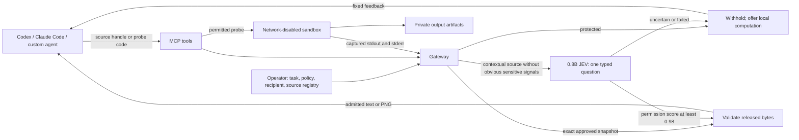

# Policy-first observation gateway

The active package is `jev_gtw`. It keeps original data in the gateway process
until a view is admitted. It has no training loop, reward model, optimizer or
automatic calibration step. The default inspector is the frozen 0.8B Instant
checkpoint, served through the official vLLM-backed runtime.

## Access comes from the host

| Source policy | Behavior |
|---|---|
| `local` (default) | Withhold the view without opening the source; optionally compute locally. |
| `deny` | Withhold and reject computation. |
| `approved` | Release only the exact operator-reviewed text/image fingerprint. Changed bytes fail closed. |
| `contextual` | Apply text vetoes, then one typed JEV permission question. Release only at score ≥0.98. |

`local_compute` is a separate permission. A local source does not automatically
permit its derived outputs to leave. `probe_view` defaults to `local`; the
operator may explicitly enable contextual review of summaries. When several
sources feed a probe, every source must permit that output review.

This arrangement makes high withholding a property of source policy. JEV is an
additional reviewer for an optional contextual path. It cannot override a
protected source. The numerical threshold is conservative and **not a calibrated
98% safety guarantee**. The completed study found substantial over-blocking;
see [results](RESULTS.md).

## Release boundary

`core.py` issues a one-use capability tied to task, policy, recipient, session,
history and the captured view. `messages` consumes it; `validate_request` checks
final tool and multimodal payloads. Custom harnesses must validate after their
last formatting step. The MCP adapter returns only reviewed content and fixed
feedback. It has no unrestricted filesystem resource endpoint.

`service.py` resolves operator-defined handles. Source reads use bounded,
descriptor-relative opens and reject symlinks and special files. A denied or
local-only view does not open the source. Context changes and admitted history
must come from the trusted harness, not an agent-supplied authorization claim.

`judge.py` sends one binary typed question, with no generated explanation, no
automatic redaction retry and no separate relevance call. Proxy forwarding and
redirects are disabled. Inference uses loopback unless the operator explicitly
allows a private host. Inspector errors and malformed scores hold the view.

Images currently accept bounded, metadata-free RGB PNGs. Unsupported formats
are withheld. There is no OCR, automatic pixel redaction or medical PHI taxonomy
classifier. Text signal categories are narrow vetoes, not exhaustive detection.

## Local probes

`gateway_compute` accepts Python and up to eight registered input handles.
The server snapshots permitted inputs, mounts them read-only into a configured
Docker or Apptainer container, disables networking and omits host credentials.
It bounds execution time and captured output. Files under `/outputs` stay in an
owner-only artifact directory; the agent receives a random receipt. Return codes
and exception messages are not forwarded through an unreviewed channel.

Docker requires an image digest; Apptainer requires a local SIF with a verified
SHA256. There is **no host execution fallback**. Provision server-level CPU,
memory, process and disk quotas too: the adapter is not a kernel security
boundary, and a per-file size limit is not a total filesystem quota. Private
artifacts require an operator-managed retention policy.

## Deployment boundary

The skill guides the coding agent. The host must keep protected files and
configuration inaccessible to the agent's other tools, preferably on a separate
server/account. Native shell, native image viewers, search results, other MCP
servers and direct chat uploads do not automatically pass through this gateway.
Plain system/user/assistant text and arbitrary provider API fields are not
covered by the supplied message validator.

This is a prototype observation gateway, not pre-execution authorization for
every agent command or a network firewall. Fixed feedback, timing and repeated
query patterns can themselves convey information. Contextual review of arbitrary
probe output does not establish protection against encoded or semantic covert
channels. Use local-only outputs when those disclosures must be prevented.
